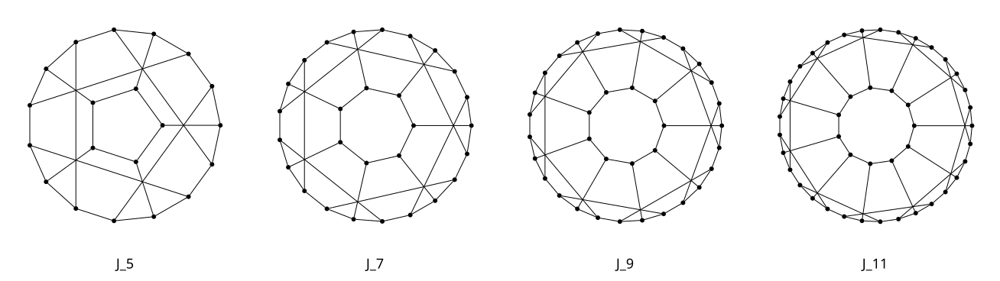

# -*- mode: org;  coding: utf-8; -*-
#+title: Graphs, Data Structures & Algorithms

#+BEGIN_SRC text
For the Snark's a peculiar creature, that won't be caught in a commonplace way.
—Lewis Carroll
#+END_SRC

A Graph module for Janet that provides directed, undirected and weighted graphs; multigraphs and trees; distance matrices; a collection of algorithms for traversal, connectivity, flow, centrality, clustering, matching, planarity and graph colourings; tournaments and causal-inference primitives; Petri nets; random graphs; suffix-tree (string) algorithms; graph drawing and layout; and import/export in various formats.

Per-topic documentation and examples can be found in [[file:doc/overview.org][doc/overview]] and [[file:doc/topics/][doc/topics]]

* Installation

The library can be installed with jpm

#+BEGIN_SRC shell
jpm install https://codeberg.org/zzkt/snark
#+END_SRC

…or added to project.janet

#+BEGIN_SRC janet
:dependencies ["https://codeberg.com/zzkt/snark"]
#+END_SRC

Most of the library can be imported using the =graphs= module (see: [[file:graphs/init.janet][graphs/init]] for specifics)

#+begin_src janet
(import graphs :prefix "")
#+end_src

...or individual modules can be imported directly for a smaller surface.

#+BEGIN_SRC janet
(import graphs/simple-graph :prefix "")
(import graphs/multigraph :prefix "")
(import graphs/metrics :prefix "")
(import graphs/connectivity :prefix "")
#+end_src

Some features are /not/ imported along with the rest of the library, either for performance or clarity. Petri-nets require an explicit import. To use suffix trees or compressed suffix trees, import one or the other, not both (see [[Suffix Trees & Strings]] for details).

#+begin_src janet
(import graphs/petri-net :prefix "")  # the Petri-net model
(import graphs/suffix-tree :as st)    # suffix trees
(import graphs/cst :as cst)           # compressed suffix trees
#+end_src

* Core data structures
see: [[file:graphs/types.janet][graphs/types]] and [[file:graphs/init.janet][graphs/init]]

The graph types are defined as a small set of data structures that share a common interface

- =:graph= — a simple undirected, unweighted graph
- =:digraph= — directed graph with optional edge weights
- =:weighted-graph= — undirected weighted graph
- =:tree= and =:weighted-tree= — rooted trees
- =:multigraph= and =:multidigraph= — graphs with multiple edges

Other potentially useful data structures;

- =:distance-matrix= — labelled N×N symmetric distance matrix
- =:binary-min-heap= — array-based priority queue
- =:suffix-tree= and =:cst= — suffix trees for string indexing and search

* Traversal & ordering
see: [[file:graphs/traversal.janet][graphs/traversal]] and [[file:graphs/hamiltonian.janet][graphs/hamiltonian]]

- *BFS* — breadth-first search returning distances or paths
- *DFS* — depth-first search with pre/post ordering
- *Topological Sort* — Kahn's algorithm
- *DAG Shortest Paths* — single-source shortest path on DAGs in topological order
- *Strongly Connected Components* — Kosaraju's algorithm
- *Semi-Connected* — if the condensation DAG forms a chain
- *Eulerian Cycle* — Hierholzer's algorithm
- *Hamiltonian Cycle/Path* — exact backtracking search, with conditionals

* Shortest paths & weighted graphs
see: [[file:graphs/weighted-graph.janet][graphs/weighted-graph]], [[file:graphs/shortest-paths.janet][graphs/shortest-paths]], [[file:graphs/distance-matrix.janet][graphs/distance-matrix]]

- *Dijkstra* — single-source and all-targets shortest paths over undirected weighted graphs
- *All-Pairs Shortest Paths* — Floyd-Warshall distances and BFS-based all-pairs on any graph type
- *Minimum Spanning Tree* — Prim's algorithm
- *Distance Matrix* — labelled N×N distance matrix with conversions to/from weighted graphs

* DAG analysis & causal inference
see: [[file:graphs/dag.janet][graphs/dag]]

- *Acyclicity* — =is-acyclic?= and =is-aperiodic?= on directed graphs
- *Generations* — topological generation layers of the Kahn partition
- *Ancestors & Descendants* — reachable sets in both directions along edges
- *Transitive Closure & Reduction* — minimal equivalent reachability DAG
- *Longest Path* — DAG longest path(s) and length
- *Antichains* — inclusion maximal sets of mutually incomparable nodes
- *Colliders & V-Structures* — immorality detection for causal discovery

*Tournaments* (see: [[file:graphs/tournament.janet][graphs/tournament]])

- *Recognition* — =is-tournament?= on a digraph
- *Adjacency Matrix* — =tournament-matrix= and score/reversal sequences
- *Structure* — =strong-tournament?=, =regular-tournament?=, =transitive-tournament?=
- *Kings* — =is-tournament-king?=, =tournament-kings= (where every tournament has a king)
- *Hamiltonian Path* — =tournament-hamiltonian-path= (every tournament has one)

* Cycle analysis
see: [[file:graphs/cycles.janet][graphs/cycles]]

- *Cycle Detection* — directed (topological) and undirected (DFS) cycle detection
- *Cycle Basis* — fundamental cycles of an undirected graph
- *Simple Cycles* — all simple cycles of a directed graph

* Flow & cut
see: [[file:graphs/flow.janet][graphs/flow]] and [[file:graphs/cuts.janet][graphs/cuts]]

- *Edmonds-Karp* — BFS-based max flow
- *Dinic* — level graph and blocking flow. O(V²E) in general, often faster in practice.
- *Min-Cut* — minimum s-t cut, read back from a previous flow result
- *Cuts & Expansion* — on undirected graphs: volume, cut-size, edge/node boundaries, edge/node/boundary expansion, mixing expansion, normalized cut, conductance

* Connectivity
see: [[file:graphs/connectivity.janet][graphs/connectivity]] and [[file:graphs/lca.janet][graphs/lca]]

- *Connected Components* — BFS/DFS for connected components (weakly connected for directed graphs)
- *Articulation Points* — Tarjan's DFS algorithm (cut vertices)
- *Bridges* — Tarjan's DFS algorithm (cut edges)
- *Biconnected Components* — edge-based 2-connected components
- *Edge & Vertex Connectivity* — min cut size and min vertex cut of a connected graph (edge-Menger & vertex-Menger)
- *Offline LCA* — =tarjan-lca= and a stack-safe =tarjan-lca-iterative=

* Planarity
see: [[file:graphs/planarity.janet][graphs/planarity]]

- *Planarity Test* — Demoucron-Malgrange-Pertuiset (DMP) algorithm
- *Planar Embedding* — =planar-faces= for finding face boundary walks

* Centrality & ranking
see: [[file:graphs/centrality.janet][graphs/centrality]] and [[file:graphs/pagerank.janet][graphs/pagerank]]

- *Degree Centrality* — normalized, with in/out variants
- *Closeness Centrality* — Wasserman-Faust on disconnected graphs (inward for directed)
- *Betweenness Centrality* — Brandes' algorithm (unweighted)
- *Eigenvector Centrality* — power iteration, max-normalized
- *Katz Centrality* — using fixed-point iteration, with optional normalization
- *Harmonic Centrality* — inward distances for directed, with optional normalization
- *Percolation Centrality* — Brandes-style accumulation weighted by node state
- *PageRank* — power iteration with some convergence options
- *Personalized PageRank* — with custom =:personalization= teleport distribution

* Clustering & community detection
see: [[file:graphs/clustering.janet][graphs/clustering]]

- *Louvain* — modularity-based heuristic, greedy local optimization
- *Leiden* — Louvain variant with refinement phase for improved partitioning

* Metrics
see: [[file:graphs/metrics.janet][graphs/metrics]]

- *Density* — ratio of actual to possible edges
- *Diameter* — furthest distance form any two nodes (BFS from each node)
- *Eccentricity* — max distance from a node to any other
- *Radius & Center* — nodes achieving minimum eccentricity
- *Clustering Coefficients* — local (per-node) and global (transitivity ratio)
- *Average Path Length* — mean over all reachable pairs

* Similarity
see: [[file:graphs/similarity.janet][graphs/similarity]]

- *Cosine Similarity* — weighted adjacency-vector overlap
- *Jaccard Similarity* — |N(u) ∩ N(v)| / |N(u) ∪ N(v)|
- *kNN* — top-k most similar nodes by Jaccard or cosine

* Cores & Shells
see: [[file:graphs/cores.janet][graphs/cores]]

- *Core Number* — maximum $k$ such that the node belongs to a k-core
- *k-Core / k-Shell / k-Crust / k-Corona* — nested peeling decompositions, each as a =:graph=
- *Onion Layers* — layered view from shell peeling

* Graph Colouring
see: [[file:graphs/colouring.janet][graphs/colouring]]

- *Vertex Colouring* — =greedy-colour= (Welsh–Powell), =chromatic-number=, =is-proper-colouring?=
- *Edge Colouring* — =edge-colour-greedy= (greedy), =vizing-edge-colour=, =edge-chromatic-number=
- *Extremal Graphs* — =make-turan-graph=, =turan-number= for triangle-free bounds

* Matching, Cliques & Coverings
see: [[file:graphs/matching.janet][graphs/matching]]

- *Matching* — =maximal-matching=, =maximum-matching=, =maximum-bipartite-matching=, with =is-matching?=, =is-maximal-matching?=, =is-perfect-matching?= using Edmonds' blossom (general) and Kuhn (bipartite)
- *Coverings & Independence* — =minimum-vertex-cover=, =maximum-independent-set=, =bipartite-sets=, =satisfies-hall-condition?=
- *Cliques* — =find-cliques= (Bron-Kerbosch), =find-all-cliques=, =node-clique-number=, =number-of-cliques=

* Spanning Trees
see: [[file:graphs/spanning-tree.janet][graphs/spanning-tree]]

- *Matrix-Tree Theorem* — =count-spanning-trees= via the graph Laplacian
- *BEST Theorem* — =count-eulerian-circuits= of an Eulerian digraph
- *Linear Algebra helpers* — =graph-laplacian=, =matrix-determinant= (exact, fraction-free Bareiss)

* Petri Nets
see: [[file:graphs/petri-net.janet][graphs/petri-net]] for the model and [[file:graphs/export/petri-net.janet][export/petri-net]] for the exporters

The Petri-net module is not imported by default and requires an explicit import

#+begin_src janet
(import graphs/petri-net :prefix "")
#+end_src

- *Petri Nets* — place/transition nets with weighted arcs as multiplicities
- *Firing* — fire sequences, and reproducible simulation with =petri-net-simulate= (using =:steps= and =:seed=)
- *Reachability* — shortest =petri-net-firing-sequence=, =petri-net-state-space=, =petri-net-state-graph=.
- *Coverability* — Karp–Miller with ω (infinite token counts). =petri-net-bounded?=, =petri-net-safe?=
- *Liveness* — =petri-net-live?=, =petri-net-transition-live?=, =petri-net-deadlock?=, =petri-net-dead?=
- *Invariants* — exact rational basis (S- and T-invariants)
- *Structure* — place/transition arcs, source/sink places and transitions, bounded capacities
- *Export* — Graphviz, SVG & TikZ renderer

* Random Graphs
see: [[file:graphs/random-graph.janet][graphs/random-graph]]

- *Erdős–Rényi* — =random-graph= ($G(n,p)$) and =random-graph-edges= ($G(n,m)$)
- *Preferential Attachment* — =barabasi-albert= scale-free networks

All random graphs can accept an optional =seed= for reproducible output.

* Degree Sequences
see: [[file:graphs/sequence.janet][graphs/sequence]]

- *Havel-Hakimi* — =is-valid-havel-hakimi?=
- *Erdős-Gallai* — =is-valid-erdos-gallai?=
- *Pseudographical, Multigraphical*, and *Digraphical* realisability

* Suffix Trees & Strings
see: [[file:graphs/suffix-tree.janet][graphs/suffix-tree]] and [[file:graphs/cst.janet][graphs/cst]]

These modules are /not/ exported by default and need to be imported explicitly. They share a common interface and can be used interchangeably. The differences are detailed in [[file:doc/topics/strings.org][doc/topics/strings]].

#+BEGIN_SRC janet
(import graphs/suffix-tree :as st)   # suffix trees
(import graphs/cst :as cst)          # compressed suffix trees
#+END_SRC

- *Suffix Tree* built from a string — =st/suffix-tree=, =st/suffix-search=, =st/longest-repeated-substring=
- *Suffix Array* — =st/suffix-array= from text, or from a suffix tree.
- *Compressed Suffix Tree (CST)* — =cst/cst=, =cst/suffix-search=, =cst/cst-lcp=, the compressed SA/LCP representation of a suffix tree.

* Graph Import
see: =graphs/import= directory

- *Adjacency list/matrix*  — =graph-from-adjacency-list= and =graph-from-adjacency-matrix=
- *DOT* — small graph importer, =graph-from-dot= from text, or =import-dot= file
- *GEXF* — graph importer, =graph-from-gexf= and =import-gexf=
- *House of Graphs* — graph importer, =import-hog= by numeric id using the online API
- *By extension* — =import-file= dispatches on =.dot= or =.gexf=, and raises otherwise

* Graph Layout & Export
see: =graphs/export= and =graphs/layout= directories

- *DOT* — =to-dot= to export a .dot file for rendering with Graphviz
- *GEXF* — =to-gexf= for Gephi
- *TikZ* — =to-tikz= TikZ/PGF for LaTeX
- *Cytoscape.js* — =to-cytoscape= for self-contained HTML pages using cytoscape.js
- *SVG* — =to-svg= for SVG output via Graphviz, plus a native renderer for the circular-arc Lombardi/poly-arc layouts whose edges Graphviz cannot draw

The Graphviz engines are available in the SVG and DOT exporters, including; =dot=, =neato=, =circo=, =fdp=, =sfdp=, =twopi=, =osage= and =patchwork=

Internal layout algorithms can be accessed through =graph-layout= (or the =layout-*= functions directly) and inlcude; =dag=, =tala= (TALA/D2), =force=, =spring=, =circle=, =tree=, =radial=, =orthogonal=, =spectral=, =lombardi= and =polyarc=, and the phylogram family (=phylogenetic=, =phylogram=, =phylogenetic-tree=, =unrooted-phylogram=, and =unrooted-phylogenetic-tree=).

* References

*Texts*
- Diestel (2025) *Graph Theory*, 6th ed. Springer GTM-173.
- Bondy & Murty (2008) *Graph Theory*. Springer GTM-244.
- Bollobás (1998) *Modern Graph Theory*. Springer GTM-184.
- Zhao (2023). *Graph Theory and Additive Combinatorics*. Cambridge University Press.
- Cormen, Leiserson, Rivest & Stein (2022) *Introduction to Algorithms*, 4th ed. MIT Press.

*Networks in particular*
- Newman (2018) *Networks*, 2nd ed. Oxford University Press.

*Graph Drawing and Visualization*
- Tamassia (2013) *Handbook of Graph Drawing and Visualization*. CRC Press
