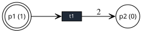

# -*- mode: org;  coding: utf-8; -*-
#+PROPERTY: header-args:janet :tangle ../examples/petri-net.janet :comments org
#+title: Petri Nets

*Modules:* [[file:../../graphs/petri-net.janet][petri-net]] (model), [[file:../../graphs/export/petri-net.janet][petri-net]] (exporters)

Place/transition nets over a =:digraph=. Arcs are weighted multiplicities where a place→transition arc supplies tokens (input) and a transition→place arc returns them (output).

The Petri-net model is not exported from the =graphs= module by default and must be explicitly imported. There are three exporters available; =petri-net-to-dot=, =petri-net-to-tikz= and =petri-net-state-space-to-dot=.

* Summary

*Construction* — =petri-net-from-arcs= builds a net from parallel arrays of places, transitions, and =[source target weight]= arcs, with an optional initial marking. The constructor requires a mutable =:array= for the arc/place lists.

*Firing* — =petri-net-enabled?=, =petri-net-fire=, =petri-net-try-fire=, =petri-net-fire-sequence=, =petri-net-can-fire-sequence?=, =petri-net-fire-effect=, =petri-net-enabled-transitions=

*Marking* — =petri-net-marking=, =petri-net-tokens=, =petri-net-token-count=, =petri-net-set-marking=, optional =petri-net-place-capacity=, =petri-net-set-place-capacity=

*Reachability* — =petri-net-reachable-markings=, =petri-net-reachable?=, =petri-net-firing-sequence= (shortest), =petri-net-state-space=, =petri-net-state-graph=, =petri-net-state-space-to-dot=

*Coverability & liveness* — using Karp–Miller =petri-net-coverability-tree= (with ω), =petri-net-bounded?=, =petri-net-safe?=, =petri-net-live?=, =petri-net-transition-live?=, =petri-net-deadlock?=, =petri-net-dead?=

*Simulation* — =petri-net-simulate= takes =:steps= and =:seed= for reproducible runs

*Invariants* — rational RREF =petri-net-invariant-space= (S- and T-invariant bases), =petri-net-consistent?=, bounded enumeration =petri-net-t-invariants=, =petri-net-s-invariants=, =petri-net-fire-vectors=

*Structure* — =petri-net-pure?=, =petri-net-ordinary?=, =petri-net-source-place?=, =petri-net-sink-place?=

*Visualisation & export* — =petri-net-to-dot=, =petri-net-to-tikz=, and =petri-net-state-space-to-dot= can be found in [[file:~/code/codeberg/snark/graphs/export/petri-net.janet][export/petri-net]]

* Example

#+begin_src janet :session examples :results none
(import graphs/petri-net :prefix "")
(import graphs/export/petri-net :prefix "ex/")
#+end_src

A net can be constructed using =make-petri-net=, which provides a range of options, or using =petri-net-from-arcs= which is simpler in most cases.

#+begin_src janet :session examples :results output
(def p0 (petri-net-from-arcs
         @["p1" "p2"]             # places
         @["t1" "t2"]             # transitions
         @[["p1" "t1" 1]          # arcs [source target weight]
           ["t1" "p2" 1]
           ["p2" "t2" 1]
           ["t2" "p1" 1]]))

(printf "A Petri-net with %p places and %p transitions."
        (petri-net-place-count p0) (petri-net-transition-count p0))
#+end_src

#+RESULTS:
: A Petri-net with 2 places and 2 transitions.

A producer net. =t1= consumes a token from =p1= and produces two into =p2=

#+begin_src janet :session examples :results output
(def pn (petri-net-from-arcs
          @["p1" "p2"] @["t1"]
          @[["p1" "t1"] ["t1" "p2" 2]]
          @{"p1" 1}))

(printf "enabled: %p" (petri-net-enabled-transitions pn))

(petri-net-fire pn "t1")

(printf "marking after firing: %p" (petri-net-marking pn))

(printf "bounded? %p\nsafe? %p" (petri-net-bounded? pn) (petri-net-safe? pn))
#+end_src

#+RESULTS:
: enabled: @["t1"]
: marking after firing: @{"p1" 0 "p2" 2}
: bounded? true
: safe? false

Firing preserves the S-invariant =2·p1 + p2=

#+begin_src janet :session examples :results output
(def pn2 (petri-net-from-arcs
           @["p1" "p2"] @["t1"]
           @[["p1" "t1"] ["t1" "p2" 2]]))

(def inv (petri-net-invariant-space pn2))

(printf "S-invariant basis: %p" (get inv :places))
(printf "consistent with {p2 2}? %p" (petri-net-consistent? pn2 @{"p2" 2}))
#+end_src

#+RESULTS:
: S-invariant basis: @[@[2 1]]
: consistent with {p2 2}? false

Reachability. A token shuttles =x → y → x= around a cycle.

#+begin_src janet :session examples :results output
(def cy (petri-net-from-arcs
          @["x" "y"] @["s" "f"]
          @[["x" "s"] ["s" "y"] ["y" "f"] ["f" "x"]]
          @{"x" 1}))

(printf "firing sequence to {y 1}: %p" (petri-net-firing-sequence cy @{"y" 1}))

(def marking->str (fn [m] (string/join (map (fn [kv] (string (kv 0) "=" (kv 1)))
                                             (pairs m)) "|")))
(printf "reachable markings: %s"
        (string/join (map marking->str (petri-net-reachable-markings cy)) " "))

(printf "live? %p\ndeadlock? %p" (petri-net-live? cy) (petri-net-deadlock? cy))
#+end_src

#+RESULTS:
: firing sequence to {y 1}: @["s"]
: reachable markings: x=1|y=0 x=0|y=1
: live? true
: deadlock? false

Unbounded nets have infinite entries in the coverability tree

#+begin_src janet :session examples :results output
(def unb (petri-net-from-arcs
           @["p"] @["t"]
           @[["p" "t"] ["t" "p" 2]]
           @{"p" 1}))

(printf "bounded? %p" (petri-net-bounded? unb))

(def ct (petri-net-coverability-tree unb))

(printf "coverability tree contains omega? %p"
        (some (fn [n] (some (fn [c] (= c math/inf)) (values (get n :marking))))
              (get ct :nodes)))
#+end_src

#+RESULTS:
: bounded? false
: coverability tree contains omega? true

Reproducible simulation using a =:seed=

#+begin_src janet :session examples :results output
(def sim (petri-net-from-arcs
           @["a" "b"] @["x"]
           @[["a" "x"] ["x" "b"] ["b" "x"]]
           @{"a" 1}))

(petri-net-simulate sim :steps 5 :seed 7)
(printf "tokens conserved: %p" (petri-net-token-count sim))
#+end_src

#+RESULTS:
: tokens conserved: 1

Render with Graphviz

#+begin_src janet :session examples :results output :wrap src dot
(def pn3 (petri-net-from-arcs
           @["p1" "p2"] @["t1"]
           @[["p1" "t1"] ["t1" "p2" 2]]
           @{"p1" 1}))

(print (ex/petri-net-to-dot pn3))
#+end_src

#+RESULTS:
#+begin_src dot
digraph "petri" {
  rankdir=LR;
  nodesep="0.6";
  ranksep="0.7";
  splines=true;esep=12;
  node [fontname="Fira Sans",margin=0];
  "p1" [shape=doublecircle,style=filled,fillcolor=white,label="p1 (1)",fixedsize=true,width=0.55,height=0.55,fontsize=11,pos="0.0,56.7!"];
  "p2" [shape=circle,style=filled,fillcolor=white,label="p2 (0)",fixedsize=true,width=0.55,height=0.55,fontsize=11,pos="113.4,56.7!"];
  "t1" [shape=box,style=filled,fillcolor="#1f2937",fontcolor=white,label="t1",fixedsize=true,width=0.45,height=0.22,fontsize=9,pos="56.7,56.7!"];
  "p1" -> "t1" [arrowhead=vee];
  "t1" -> "p2" [arrowhead=vee,label=2];
}

#+end_src

#+RESULTS:

* References
- Petri 1962, “Kommunikationsnetze”.
- Reisig & Rozenberg, “Petri Nets”, /Lectures on Concurrency and Synchronization/.
- Karp & Miller 1969 (coverability tree).
