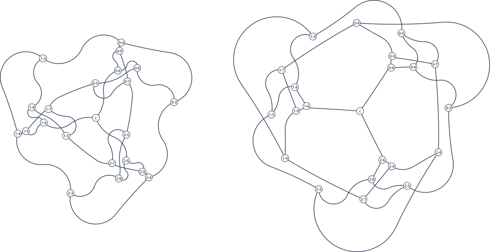
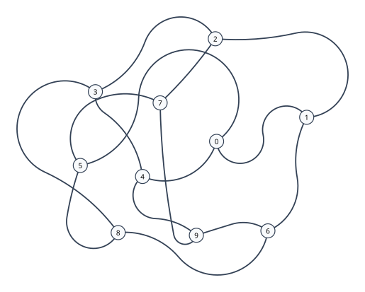
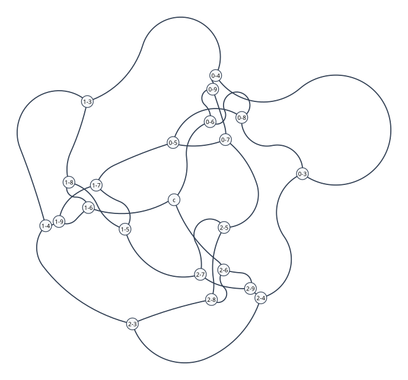
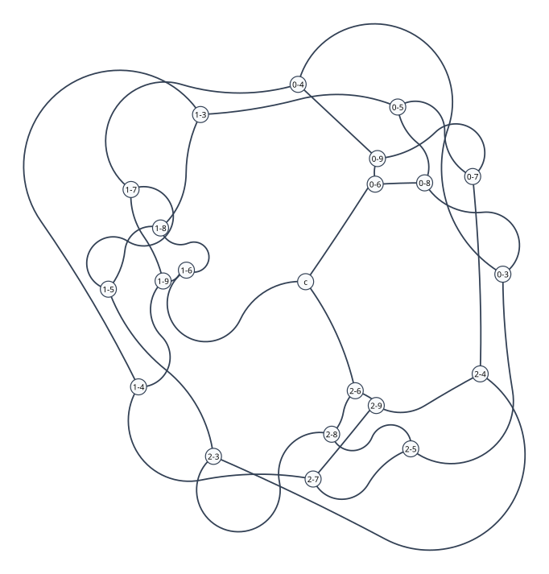
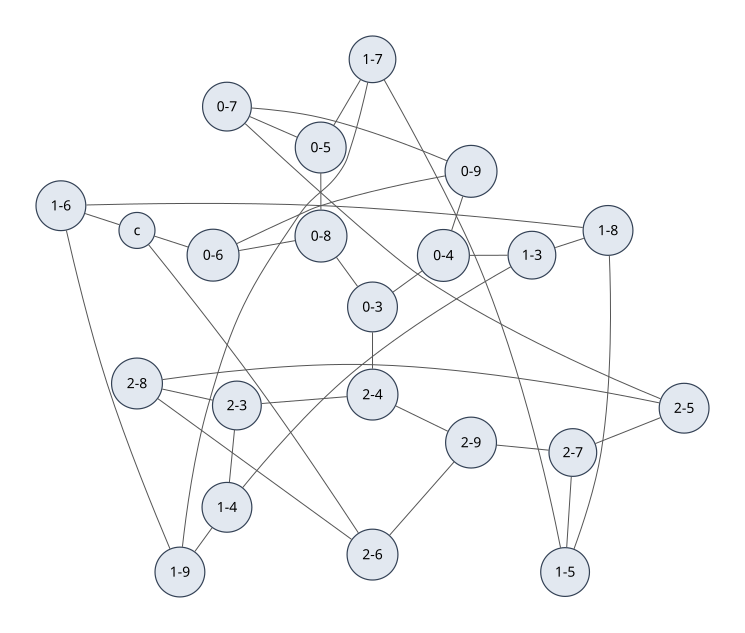
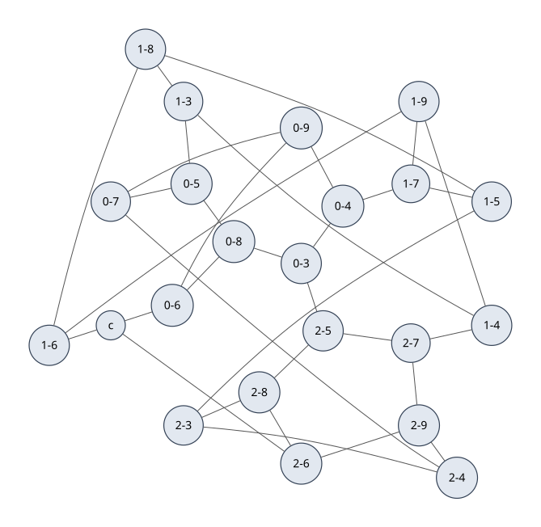
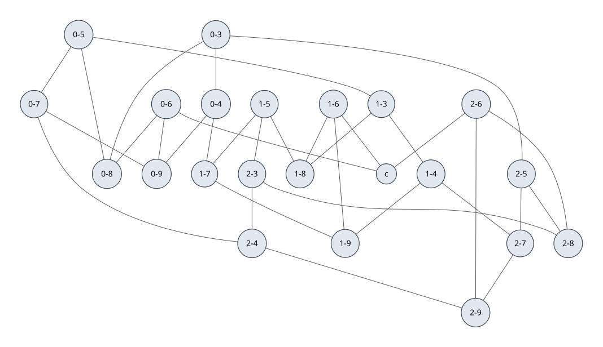

# -*- mode: org; coding: utf-8; -*-
#+title: The Loupekine snarks

#+begin_quote
Let us take them in order. The first is the taste,
   Which is meagre and hollow, but crisp
#+end_quote

A *snark* appears when an undirected graph, with three edges per vertex, has edges unable to be coloured with only three colors. It is a bridgeless cubic graph (and on occasions cyclically 4-edge-connected). The smallest snark is the 10 vertex *Petersen graph*, and the two next-smallest snarks each contain 22 vertices. These are known as the *Loupekine snarks*.

* The Loupekine construction

The construction treats every snark as a ring of blocks, each block being a smaller snark with a 3-vertex path removed, connected together through a central piece.

A block is formed by deleting the vertices of a path $x–y–z$ from a base graph (small, often cubic). The two off–path neighbours of the endpoint $x$ and the two off–path neighbours of $z$ become border vertices of degree 2, as does the single off–path neighbour of the middle vertex $y$.

An odd number $\geq3$ of blocks is arranged around a cycle. Consecutive blocks are joined by a pair of edges. Each border vertex gains one edge, returning to degree 3.

The middle-vertex neighbours $w$ (one per block) are joined to a central graph that is cubic except at its attachments. In the simplest case the central graph is a three leaf star, a single vertex of degree 3 whose leaves are the blocks' $w$.

For the smallest Loupekine snarks, each block is a copy of the Petersen graph, the cycle has three blocks, and two non-isomorphic 22-vertex snarks emerge. The two graphs differ only in how the pairs of edges between consecutive blocks are chosen.

* Petersen and the block

Start with the Petersen graph, the smallest snark. The Petersen graph is constructed with an outer pentagon $0\dots4$, inner pentagram $5\dots9$, and spokes between matching labels.

#+BEGIN_SRC janet :session loupekine :tangle loupekine.janet :results none
(import graphs :prefix "")
#+END_SRC

#+BEGIN_SRC janet :session loupekine :tangle loupekine.janet :results none
(defn petersen []
  (def g (make-graph))
  (add-nodes g (range 10))
  (each e @[[0 1] [1 2] [2 3] [3 4] [4 0]
            [5 7] [7 9] [9 6] [6 8] [8 5]
            [0 5] [1 6] [2 7] [3 8] [4 9]]
    (add-edge g (e 0) (e 1)))
  g)
#+END_SRC

Deleting the path $0–1–2$ leaves seven vertices arranged as a ring with five border vertices (degree 2) and two interior vertices (degree 3)

#+BEGIN_SRC janet :session loupekine :tangle loupekine.janet :results none
(def block (petersen))      # start with Petersen graph
(remove-nodes block 0 1 2)  # remove the path 0-1-2 (also removes incident edges)
#+END_SRC

* Assembling of the snark

Three blocks $B_0,B_1,B_2$ around a cycle, block $i$ linked to block $i+1$ (mod 3). Each gap uses the pair $\{u,v\}$ of $B_i$ and the pair $\{x,y\}$ of $B_{i+1}$. There are two ways to match the four vertices by a pair of edges

- *crossed pairing* $u_i \sim x_{i+1}$, $v_i \sim y_{i+1}$
- *parallel pairing* $u_i \sim y_{i+1}$, $v_i \sim x_{i+1}$

The two pairings define the first two Loupekine snarks. The central graph in both cases is a single added vertex joined to $w_0,w_1,w_2$ (a three-leaf star, where leaves connect blocks at $w$). There are $3\times7+1 = 22$ vertices and $(3\times8)+(3\times2)+3 = 33$ edges. Every vertex is of degree 3.

#+BEGIN_SRC janet :session loupekine :tangle loupekine.janet :results none
(defn loupekine-snark
  [twin]
  (def g (make-graph))
  (each i (range 3)
    (def b block)
    (each v (nodes b)
      (add-node g (string i "-" v)))
    (each e (seq [v :in (nodes b)
                  w :in (neighbours b v)
                  :when (< v w)]
              [v w])
      (add-edge g (string i "-" (e 0)) (string i "-" (e 1)))))
  (each i (range 3)
    (def j (mod (+ i 1) 3))
    (def ui (string i "-4"))
    (def vi (string i "-5"))
    (def xj (string j "-3"))
    (def yj (string j "-7"))
    (if (= twin :first)
      (do (add-edges g [ui xj] [vi yj]))
      (do (add-edges g [ui yj] [vi xj]))))
  (add-node g "c")
  (each i (range 3)
    (add-edge g "c" (string i "-6")))
  g)
#+END_SRC

* Verification of the snark

The invariants can be checked using =girth=, =graph-k-cycle-count, =chromatic-index=, =edge-connectivity=, =vertex-connectivity= and =is-planar?=

#+BEGIN_SRC janet :session loupekine :tangle loupekine.janet :results output
(defn invariants [name g]
  (printf "%-8s %2d vertices, %2d edges, %s, girth %d, %s, %s"
          name (node-count g) (edge-count g)
          (if (all (fn [v] (= 3 (degree g v))) (nodes g)) "cubic" "not cubic")
          (girth g)
          (if (connected? g) "connected" "disconnected")
          (if (is-planar? g) "planar" "non-planar"))
  (printf "%-8s 𝛘' is %d, edge-connectivity %d, vertex-connectivity %d"
          name (chromatic-index g) (edge-connectivity g)
          (vertex-connectivity g))
  (printf "%-8s %d five-cycles, %d six-cycles\n"
          name (graph-k-cycle-count g 5) (graph-k-cycle-count g 6)))

# build and verify
(def first-snark (loupekine-snark :first))
(def second-snark (loupekine-snark :second))

(invariants "Petersen graph: " (petersen))
(invariants "1st Loupekine snark: " first-snark)
(invariants "2nd Loupekine snark: " second-snark)

(printf "The two Loupekine snarks are %s.\n"
        (if (not= (graph-k-cycle-count first-snark 6)
                  (graph-k-cycle-count second-snark 6))
          "not isomorphic" "isomorphic"))
#+END_SRC

#+RESULTS:
#+begin_example
Petersen graph:  10 vertices, 15 edges, cubic, girth 5, connected, non-planar
Petersen graph:  𝛘' is 4, edge-connectivity 3, vertex-connectivity 3
Petersen graph:  12 five-cycles, 10 six-cycles

1st Loupekine snark:  22 vertices, 33 edges, cubic, girth 5, connected, non-planar
1st Loupekine snark:  𝛘' is 4, edge-connectivity 3, vertex-connectivity 3
1st Loupekine snark:  6 five-cycles, 5 six-cycles

2nd Loupekine snark:  22 vertices, 33 edges, cubic, girth 5, connected, non-planar
2nd Loupekine snark:  𝛘' is 4, edge-connectivity 3, vertex-connectivity 3
2nd Loupekine snark:  6 five-cycles, 3 six-cycles

The two Loupekine snarks are not isomorphic.

#+end_example
** Adjacency lists

The two snarks can be imported from House of Graphs, as [[https://houseofgraphs.org/graphs/1215][1215]] for the first Loupekine snark (the crossed pairing) and [[https://houseofgraphs.org/graphs/1217][1217]] for the second (the parallel pairing), represented as adjacency lists. New graphs can be constructed from adjacencies to check that the block construction is correct.

#+BEGIN_SRC janet :session loupekine :tangle no :results output
(def first-from-1215
  (import-hog 1215 :labels (map string (range 1 23))))

(def second-from-1217
  (import-hog 1217 :labels (map string (range 1 23))))

(invariants "HoG 1215: " first-from-1215)
(invariants "HoG 1217: " second-from-1217)

(def first-matrix (import-hog 1215 :matrix true))

(printf "HoG 1215 matrix: %d rows, %d entries per row\n"
        (length first-matrix) (length (first-matrix 0)))
#+END_SRC

#+RESULTS:
#+begin_example
HoG 1215:  22 vertices, 33 edges, cubic, girth 5, connected, non-planar
HoG 1215:  𝛘' is 4, edge-connectivity 3, vertex-connectivity 3
HoG 1215:  6 five-cycles, 5 six-cycles

HoG 1217:  22 vertices, 33 edges, cubic, girth 5, connected, non-planar
HoG 1217:  𝛘' is 4, edge-connectivity 3, vertex-connectivity 3
HoG 1217:  6 five-cycles, 3 six-cycles

HoG 1215 matrix: 22 rows, 22 entries per row
#+end_example

#+BEGIN_SRC janet :session loupekine :tangle loupekine.janet :results none
(defn parse-adjacency-lists [text]
  (def adj @{})
  (each line (string/split "\n" text)
    (def parts (string/split ":" line))
    (when (= 2 (length parts))
      (def v (scan-number (string/trim (parts 0))))
      (def ns (seq [tok :in (string/split " " (string/trim (parts 1)))
                    :when (not= tok "")] (scan-number tok)))
      (put adj v ns)))
  adj)

(defn from-adjacency-lists [adj]
  (def g (make-graph))
  (each v (keys adj) (add-node g v))
  (each v (keys adj)
    (each w (get adj v) (when (< v w) (add-edge g v w))))
  g)
#+END_SRC

Canonical encodings of the 22-vertex Loupekine snarks from House of Graphs

#+BEGIN_SRC janet :session loupekine :tangle loupekine.janet :results output
(def hog-1215-adj `1: 2 3 4
2: 1 17 22
3: 1 19 21
4: 1 18 20
5: 11 13 15
6: 12 14 16
7: 10 13 16
8: 9 14 15
9: 8 11 17
10: 7 12 17
11: 5 9 18
12: 6 10 19
13: 5 7 19
14: 6 8 18
15: 5 8 21
16: 6 7 20
17: 2 9 10
18: 4 11 14
19: 3 12 13
20: 4 16 22
21: 3 15 22
22: 2 20 21`)

(def hog-1217-adj `1: 2 3 4
2: 1 17 22
3: 1 19 21
4: 1 18 20
5: 9 11 15
6: 10 12 16
7: 8 13 16
8: 7 14 15
9: 5 14 17
10: 6 13 17
11: 5 12 18
12: 6 11 19
13: 7 10 19
14: 8 9 18
15: 5 8 21
16: 6 7 20
17: 2 9 10
18: 4 11 14
19: 3 12 13
20: 4 16 22
21: 3 15 22
22: 2 20 21`)

(def hog-1215 (from-adjacency-lists (parse-adjacency-lists hog-1215-adj)))
(def hog-1217 (from-adjacency-lists (parse-adjacency-lists hog-1217-adj)))

#  int (table label) -> label in block construction
(def relabel-1 @{1 "0-8"   2 "0-6"   3 "0-5"   4 "0-3"   5 "2-7"
                 6 "1-4"   7 "1-8"   8 "2-8"   9 "2-6"   10 "1-6"
                 11 "2-9"  12 "1-9"  13 "1-5"  14 "2-3"  15 "2-5"
                 16 "1-3"  17 "c"    18 "2-4"  19 "1-7"  20 "0-4"
                 21 "0-7"  22 "0-9"})

(def relabel-2 @{1 "0-8"   2 "0-6"   3 "0-5"   4 "0-3"   5 "2-9"
                 6 "1-9"   7 "1-5"   8 "2-3"   9 "2-6"   10 "1-6"
                 11 "2-7"  12 "1-4"  13 "1-8"  14 "2-8"  15 "2-4"
                 16 "1-7"  17 "c"    18 "2-5"  19 "1-3"  20 "0-4"
                 21 "0-7"  22 "0-9"})

(defn rename [g f]
  (def h (make-graph @{}))
  (each v (nodes g) (add-node h (f v)))
  (each e (seq [v :in (nodes g) w :in (neighbours g v) :when (< v w)] [v w])
    (add-edge h (f (e 0)) (f (e 1))))
  h)

(defn same-edge-set? [a b]
  (defn edge-keys [g]
    (sorted (seq [v :in (nodes g) w :in (neighbours g v) :when (< v w)]
                 (string v "|" w))))
  (deep= (edge-keys a) (edge-keys b)))

(printf "table-1 relabelled. is :first same as block construction? %v"
        (same-edge-set? (rename hog-1215 relabel-1) first-snark))

(printf "table-2 relabelled. is :second same as block construction? %v"
        (same-edge-set? (rename hog-1217 relabel-2) second-snark))
#+END_SRC

#+RESULTS:
: table-1 relabelled. is :first same as block construction? true
: table-2 relabelled. is :second same as block construction? true

* Drawing of the snark

The construction has a threefold rotational symmetry

$$p'(v) = \tfrac13\bigl(p(v) + R\,p(\varphi^2 v) + R^2\,p(\varphi v)\bigr)$$

where $R$ is the rotation by $120°$ about the centre $c$.

With the crossed pairing the first snark has two 6-cycles, $\{0_3,0_4,1_3,1_4,2_3,2_4\}$ (outer) and $\{0_5,0_7,1_5,1_7,2_5,2_7\}$ (inner).

#+BEGIN_SRC janet :session loupekine :tangle loupekine.janet :results none
(defn phi [node]
  (if (= node "c")
    node
    (do
      (def parts (string/split "-" node))
      (string (% (inc (scan-number (parts 0))) 3) "-" (parts 1)))))

(defn centroid-of [pos nodes]
  (var cx 0.0)
  (var cy 0.0)
  (each node nodes
    (def p (pos node))
    (set cx (+ cx (p 0)))
    (set cy (+ cy (p 1))))
  @[(/ cx (length nodes)) (/ cy (length nodes))])

(defn rotate [p c theta]
  (def cs (math/cos theta))
  (def sn (math/sin theta))
  @[(+ (c 0) (- (* cs (- (p 0) (c 0))) (* sn (- (p 1) (c 1)))))
    (+ (c 1) (+ (* sn (- (p 0) (c 0))) (* cs (- (p 1) (c 1)))))])
#+END_SRC

The spring layout is not symmetric. Averaging each vertex with its two rotated images gives symetric positions with c at the centre.

#+BEGIN_SRC janet :session loupekine :tangle loupekine.janet :results none
(defn symmetrise [pos]
  (def c (centroid-of pos (keys pos)))
  (def out @{})
  (eachp [node p] pos
    (def q (rotate (pos (phi (phi node))) c (* 2 math/pi (/ 1 3))))
    (def r (rotate (pos (phi node)) c (* 4 math/pi (/ 1 3))))
    (put out node @[(/ (+ (p 0) (q 0) (r 0)) 3)
                    (/ (+ (p 1) (q 1) (r 1)) 3)]))
  out)

(defn sym-error [pos]
  (def c (centroid-of pos (keys pos)))
  (var m 0.0)
  (eachp [node p] pos
    (def q (rotate p c (* 2 math/pi (/ 1 3))))
    (def s (pos (phi node)))
    (set m (max m (math/sqrt (+ (math/pow (- (q 0) (s 0)) 2)
                                 (math/pow (- (q 1) (s 1)) 2))))))
  m)

(defn min-gap [pos]
  (def vs (keys pos))
  (var m 1e18)
  (each i (range (length vs))
    (each j (range (+ i 1) (length vs))
      (def p (pos (vs i)))
      (def q (pos (vs j)))
      (set m (min m (math/sqrt (+ (math/pow (- (p 0) (q 0)) 2)
                                   (math/pow (- (p 1) (q 1)) 2)))))))
  m)
#+END_SRC

The drawing can be pined by a regular polygon through a set of vertices

#+BEGIN_SRC janet :session loupekine :tangle loupekine.janet :results none
(defn bounding-polygon [pos pins k pad]
  (def c (centroid-of pos pins))
  (def order (sorted
              (map (fn [node]
                     (def p (pos node))
                     @[node (math/atan2 (- (p 1) (c 1)) (- (p 0) (c 0)))])
                   pins)
              (fn [a b] (< (a 1) (b 1)))))
  (var a 0.0)
  (var b 0.0)
  (each i (range k)
    (def p (pos ((order i) 0)))
    (def qx (- (p 0) (c 0)))
    (def qy (- (p 1) (c 1)))
    (def ph (* 2 math/pi (/ i k)))
    (set a (+ a (+ (* qx (math/cos ph)) (* qy (math/sin ph)))))
    (set b (+ b (+ (* (- qx) (math/sin ph)) (* qy (math/cos ph))))))
  (def angle (math/atan2 b a))
  (def step (/ (* 2 math/pi) k))
  (var radius (/ (math/sqrt (+ (* a a) (* b b))) k))
  # grow the polygon until every vertex outside it clears the sides
  (eachp [node p] pos
    (unless (index-of node pins)
      (def dx (- (p 0) (c 0)))
      (def dy (- (p 1) (c 1)))
      (def rho (math/sqrt (+ (* dx dx) (* dy dy))))
      (def theta (math/atan2 dy dx))
      # angle to the nearest side normal
      (var d (% (- theta (+ angle (/ step 2))) step))
      (when (> d (/ step 2)) (set d (- d step)))
      (set radius (max radius (/ (* rho (math/cos d))
                                 (math/cos (/ step 2)))))))
  (set radius (+ radius pad))
  (def corners @{})
  (each i (range k)
    (def u (+ angle (* i step)))
    (put corners ((order i) 0)
         @[(+ (c 0) (* radius (math/cos u)))
           (+ (c 1) (* radius (math/sin u)))]))
  corners)

# The rim cycles
(defn pins-of [ks]
  (def out @[])
  (each k ks
    (each i (range 3)
      (array/push out (string i "-" k))))
  out)

(def outer-pins (pins-of ["3" "4"]))
(def rim-pins (pins-of ["3" "4" "5" "7"]))
#+END_SRC

The spring layout can be used as starting point for a Lombardi layout

#+BEGIN_SRC janet :session loupekine :tangle loupekine.janet :results none
(def first-base (get (layout-spring first-snark :smooth-iterations 0) :pos))
(def second-base (get (layout-spring second-snark :smooth-iterations 0) :pos))

(def first-pos (symmetrise first-base))
(def second-pos (symmetrise second-base))

# the first snark, bounded by a hexagon
(def first-drawn
  (merge first-pos (bounding-polygon first-pos outer-pins 6 0.4)))

# the second snark, bounded by a dodecagon.
(def second-drawn
  (merge second-pos (bounding-polygon second-pos rim-pins 12 1.2)))

(defn rim-radius [pos pins]
  (def c (centroid-of pos pins))
  (def p (pos (pins 0)))
  (math/sqrt (+ (math/pow (- (p 0) (c 0)) 2) (math/pow (- (p 1) (c 1)) 2))))
#+END_SRC

Check the drawings are symmetric, no vertices overlap, and are enclosed by a polygon

#+BEGIN_SRC janet :session loupekine :tangle loupekine.janet :results output
(each [name pos pins]
      [["first snark" first-drawn outer-pins] ["second snark" second-drawn rim-pins]]
  (def c (centroid-of pos pins))
  (def rr (rim-radius pos pins))
  (printf "%-12s symmetry error %.3f  closest pair %.3f  rim radius %.3f"
          name (sym-error pos) (min-gap pos) rr)
  (assert (< (sym-error pos) 1e-9))
  (assert (> (min-gap pos) 0.32))
  (eachp [node p] pos
    (unless (index-of node pins)
      (assert (< (math/sqrt (+ (math/pow (- (p 0) (c 0)) 2)
                               (math/pow (- (p 1) (c 1)) 2)))
                 rr)))))
#+END_SRC

#+RESULTS:
: first snark  symmetry error 0.000  closest pair 0.590  rim radius 5.525
: second snark symmetry error 0.000  closest pair 0.798  rim radius 6.133

#+BEGIN_SRC janet :session loupekine :tangle loupekine.janet :results none
(def svg-style
  @[:node-radius 0.25
    :node-color "#F8FAFC"
    :edge-color "#334155"
    :node-width 1.2
    :edge-width 1.8
    :label-nodes true
    :label-position :inside])
#+END_SRC

How close does the drawing get to the assigned tangent slots?

#+BEGIN_SRC janet :session loupekine :tangle loupekine.janet :results none
(defn lombardi-stats [name g & kvs]
  (def l (graph-layout g "lombardi" ;kvs))
  (def n-poly (length (filter (fn [a] (= (a :kind) :poly)) (l :arcs))))
  (def n-line (length (filter (fn [a] (= (a :kind) :line)) (l :arcs))))
  (printf "lombardi %-11s residual %.4f  arcs %d  poly %d  line %d  graph %d->%d  visible %d->%d"
          name (l :residual) (length (l :arcs)) n-poly n-line
          (l :crossings-graph-before) (l :crossings-graph-after)
          (l :crossings-visible-before) (l :crossings-visible-after)))
#+END_SRC

#+BEGIN_SRC janet :session loupekine :tangle loupekine.janet :results output
(def svg-petersen (to-svg (petersen)
                          :layout "lombardi"
                          :arc-clearance 0.35
                          :node-clearance 0.45
                          :path "img/petersen.svg"
                          :label-edges false
                          ;svg-style)) # spliced

(printf "wrote img/petersen.svg (%d bytes)\n" (length svg-petersen))

(lombardi-stats "petersen" (petersen)
            :arc-clearance 0.35
            :node-clearance 0.45)
#+END_SRC

#+RESULTS:
: wrote img/petersen.svg (4440 bytes)
:

#+BEGIN_SRC janet :session loupekine :tangle loupekine.janet :results output
(def svg-first (to-svg first-snark
                       :path "img/loupekine-first.svg"
                       :layout "lombardi"
                       :arc-clearance 0.35
                       :node-clearance 0.45
                       :base :pos
                       :pos first-drawn
                       :vertex-relax false
                       :label-edges false
                       ;svg-style)) # spliced

(printf "wrote img/loupekine-first.svg (%d bytes)" (length svg-first))

(lombardi-stats "first snark" first-snark
            :arc-clearance 0.35
            :node-clearance 0.45
            :base :pos
            :pos first-drawn
            :vertex-relax false)
#+END_SRC

#+RESULTS:
: lombardi petersen    residual 2.9170  arcs 15  poly 14  line 0  graph 4->4  visible 4->4

#+BEGIN_SRC janet :session loupekine :tangle loupekine.janet :results output
(def svg-second (to-svg second-snark
                        :path "img/loupekine-second.svg"
                        :layout "lombardi"
                        :arc-clearance 0.35
                        :node-clearance 0.45
                        :base :pos
                        :pos second-drawn
                        :vertex-relax false
                        :label-edges false
                        ;svg-style)) # spliced

(printf "wrote img/loupekine-second.svg (%d bytes)" (length svg-second))

(lombardi-stats "second snark" second-snark
                :arc-clearance 0.35
                :node-clearance 0.45
                :base :pos
                :pos second-drawn
                :vertex-relax false)
#+END_SRC

#+RESULTS:
: wrote img/loupekine-first.svg (9623 bytes)

** Petersen graph

** First Loupekine snark

** Second Loupekine snark

** Spring layout

#+BEGIN_SRC janet :session loupekine :tangle loupekine.janet :results output
(defn sw-stats [name g]
  (def l (layout-spring g))
  (printf "spring: %s crossings %d -> %d (planar %v fallback %v)"
          name (l :crossings-before) (l :crossings-after)
          (l :planar) (l :fallback)))

(sw-stats "Petersen" (petersen))
(sw-stats "First snark" first-snark)
(sw-stats "Second snark" second-snark)

(def spring-node-opts @{:shape "circle"
                        :fillcolor "#E2E8F0"
                        :color "#334155"
                        :penwidth "1.2"})

(def svg-spring-petersen (to-svg (petersen)
                                 :rankdir "LR"
                                 :layout "radial"
                                 :path "img/petersen-spring.svg"
                                 :label-edges false
                                 :node-opts spring-node-opts))

(printf "wrote img/petersen-spring.svg (%d bytes)"
        (length svg-spring-petersen))

(def svg-spring-first (to-svg first-snark
                              :rankdir "LR"
                              :layout "radial"
                              :path "img/loupekine-first-spring.svg"
                              :label-edges false
                              :node-opts spring-node-opts))

(printf "wrote img/loupekine-first-spring.svg (%d bytes)"
        (length svg-spring-first))

(def svg-spring-second (to-svg second-snark
                               :rankdir "LR"
                               :layout "radial"
                               :path "img/loupekine-second-spring.svg"
                               :label-edges false
                               :node-opts spring-node-opts))

(printf "wrote img/loupekine-second-spring.svg (%d bytes)"
        (length svg-spring-second))
#+END_SRC

#+RESULTS:
: spring: Petersen crossings 8 -> 3 (planar false fallback false)
: spring: First snark crossings 32 -> 30 (planar false fallback false)
: spring: Second snark crossings 31 -> 17 (planar false fallback false)
: wrote img/petersen-spring.svg (6372 bytes)
: wrote img/loupekine-first-spring.svg (14875 bytes)
: wrote img/loupekine-second-spring.svg (14601 bytes)

 

** graphviz
:PROPERTIES:
:header-args:dot: :file img/loupekine-second.dot.svg
:END:

#+BEGIN_SRC janet :session loupekine :tangle loupekine.janet :results output :wrap SRC dot
(print (to-dot second-snark
               :rankdir "TB"
               :label-edges false
               :node-opts @{:shape "circle"
                            :fillcolor "#E2E8F0"
                            :color "#334155"
                            :penwidth "1.2"}))
#+END_SRC

#+RESULTS:
#+begin_SRC dot
graph G {
  ranksep=1.0;
  pad=0.5;
  nodesep=0.5;
  rankdir=TB;
  splines=true;
  fontname="Fira Sans";
  node [shape="circle",penwidth="1.2",fontname="Fira Sans",color="#334155",fillcolor="#E2E8F0",style="filled"];
  "0-3";
  "0-4";
  "0-5";
  "0-6";
  "0-7";
  "0-8";
  "0-9";
  "1-3";
  "1-4";
  "1-5";
  "1-6";
  "1-7";
  "1-8";
  "1-9";
  "2-3";
  "2-4";
  "2-5";
  "2-6";
  "2-7";
  "2-8";
  "2-9";
  "c";
  "1-7" -- "1-9" [color="#555555",fontcolor="#555555",penwidth="1"]
  "2-5" -- "2-7" [color="#555555",fontcolor="#555555",penwidth="1"]
  "2-5" -- "2-8" [color="#555555",fontcolor="#555555",penwidth="1"]
  "1-3" -- "1-4" [color="#555555",fontcolor="#555555",penwidth="1"]
  "1-3" -- "1-8" [color="#555555",fontcolor="#555555",penwidth="1"]
  "0-4" -- "0-9" [color="#555555",fontcolor="#555555",penwidth="1"]
  "0-4" -- "1-7" [color="#555555",fontcolor="#555555",penwidth="1"]
  "0-7" -- "2-4" [color="#555555",fontcolor="#555555",penwidth="1"]
  "0-7" -- "0-9" [color="#555555",fontcolor="#555555",penwidth="1"]
  "1-6" -- "c" [color="#555555",fontcolor="#555555",penwidth="1"]
  "1-6" -- "1-9" [color="#555555",fontcolor="#555555",penwidth="1"]
  "1-6" -- "1-8" [color="#555555",fontcolor="#555555",penwidth="1"]
  "2-4" -- "2-9" [color="#555555",fontcolor="#555555",penwidth="1"]
  "0-3" -- "2-5" [color="#555555",fontcolor="#555555",penwidth="1"]
  "0-3" -- "0-8" [color="#555555",fontcolor="#555555",penwidth="1"]
  "0-3" -- "0-4" [color="#555555",fontcolor="#555555",penwidth="1"]
  "0-6" -- "c" [color="#555555",fontcolor="#555555",penwidth="1"]
  "0-6" -- "0-9" [color="#555555",fontcolor="#555555",penwidth="1"]
  "0-6" -- "0-8" [color="#555555",fontcolor="#555555",penwidth="1"]
  "1-5" -- "2-3" [color="#555555",fontcolor="#555555",penwidth="1"]
  "1-5" -- "1-8" [color="#555555",fontcolor="#555555",penwidth="1"]
  "1-5" -- "1-7" [color="#555555",fontcolor="#555555",penwidth="1"]
  "2-3" -- "2-4" [color="#555555",fontcolor="#555555",penwidth="1"]
  "2-3" -- "2-8" [color="#555555",fontcolor="#555555",penwidth="1"]
  "2-7" -- "2-9" [color="#555555",fontcolor="#555555",penwidth="1"]
  "1-4" -- "1-9" [color="#555555",fontcolor="#555555",penwidth="1"]
  "1-4" -- "2-7" [color="#555555",fontcolor="#555555",penwidth="1"]
  "2-6" -- "c" [color="#555555",fontcolor="#555555",penwidth="1"]
  "2-6" -- "2-9" [color="#555555",fontcolor="#555555",penwidth="1"]
  "2-6" -- "2-8" [color="#555555",fontcolor="#555555",penwidth="1"]
  "0-5" -- "0-7" [color="#555555",fontcolor="#555555",penwidth="1"]
  "0-5" -- "0-8" [color="#555555",fontcolor="#555555",penwidth="1"]
  "0-5" -- "1-3" [color="#555555",fontcolor="#555555",penwidth="1"]
}

#+end_SRC

* Further
- [[https://en.wikipedia.org/wiki/Loupekine_snark][Wikipedia > Loupekine snark]]
- Fulkerson’s Conjecture and Loupekine Snarks [[[https://www.google.com/goto?url=CAESaAHrOzAVYaAzOqYX2tfmrYucvSFDwL48sUZWxTdH4an6IyKPAgoAg4G9e00UTZKCyhZqq1bihKn9Yb_7y-P3QOo_2zvGpLNHhEKHz0dyilJuVdImdAtw6NEwnzHDElj8rvL2ReNNKgcG&gsessionid=6ScCM0nZzq26Nvo1T2WvoqSc2bgUwla0y9R4CF_q632lZxnC28gaFg][pdf]]]
- A survey on snarks and new results: Products, reducibility and a computer search. [[[https://dl.acm.org/doi/abs/10.5555/1378864.1378865][pdf]]]
